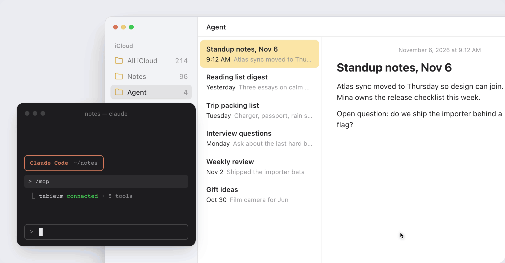
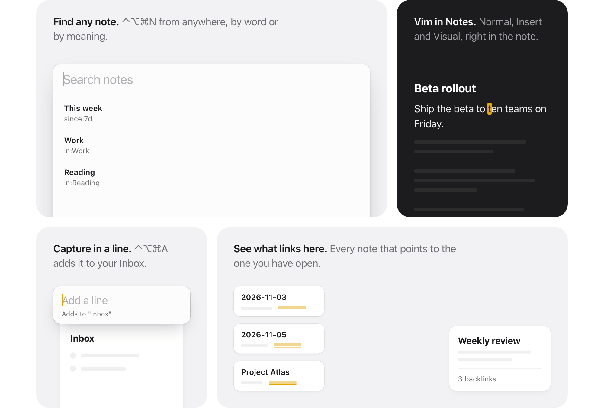

# Tabieum

Search and keyboard features beside Apple Notes, in a menu-bar app. It runs on your Mac, needs no account and has no server.



Tabieum is a separate app that works next to Notes; it is not a plug-in for it. It is not affiliated with Apple. Apple, Mac, macOS and Apple Notes are trademarks of Apple Inc., registered in the U.S. and other countries and regions.

## What you get

- **Always on:** search by keyword with a global shortcut (default ⌃⌥⌘N), quick append to an Inbox note (⌃⌥⌘A), today's note (⌃⌥⌘D), `tabieum://` URLs, backlinks, copy as Markdown or as a deeplink, Markdown shortcuts, templates and `/` commands.
- **Options you turn on:** a Vim mode, search by meaning, and AI helpers.
- **For agents:** an MCP server, so Claude Desktop, Claude Code and other clients can search your notes, and a `search` command for scripts.



[docs/features.md](docs/features.md) describes every feature and its settings.

## Install

You need macOS 15 or later, on an Apple silicon or an Intel Mac.

```sh
brew tap juhyeonni/tap
brew install --cask tabieum
```

Or download `Tabieum-<version>.zip` from [Releases](https://github.com/juhyeonni/tabieum/releases) (each has a `.sha256` file), unzip it and move `Tabieum.app` to Applications.

Apple has not notarized Tabieum, so macOS asks you to confirm the first launch. Open **System Settings > Privacy & Security** and choose **Open Anyway** ([Apple's steps](https://support.apple.com/en-us/102445)), or run `xattr -dr com.apple.quarantine /Applications/Tabieum.app` once. You can also [build it yourself](#build-from-source).

## Permissions

Tabieum asks for three permissions in System Settings > Privacy & Security and links to each page. The app opens without them; each one unlocks some features.

| Permission | Used for | Without it |
|---|---|---|
| Accessibility | Reading the Notes window and cursor for Vim mode, Markdown shortcuts, the `/` menu and the editor button | Those features do not work. Search and MCP still do. |
| Full Disk Access | Reading the Notes database, read-only, to build the search index and find the current note | Search and MCP see only what is already indexed. Copy and backlinks cannot find the note. |
| Automation (Notes) | Asking Notes which note is open, reading templates, opening today's note, quick append, and writing notes for agents if you allow it | Backlinks, copy and templates cannot see the current note. Today's note, quick append and agents do not work. |

To take a permission back, switch it off in System Settings or run `tccutil reset All dev.juhyeonni.tabieum`.

## Privacy and network

With the default settings Tabieum makes no network request and never checks for updates on its own. Nothing is sent to the developer: no account, no crash reporting.

| When | What goes out | Where to |
|---|---|---|
| You choose **Check for Updates…** | One request for the latest release | `api.github.com` |
| You choose **Install and Relaunch** | The release zip and its `.sha256` file. Nothing is sent. | `github.com` |
| You set up AI helpers and use them | The selected text or note, plus what "Ask my notes" finds | The server you set in Settings > AI Assistant |
| You turn on semantic search | macOS downloads its embedding model once. No note text. | Apple |
| You choose the tabieum-e5-small-coreml model | The model, once (about 234 MB, SHA-256 checked). No note text. | `huggingface.co` |

Your data stays in `~/Library/Application Support/dev.juhyeonni.tabieum/` (the search index and the downloaded model), `~/Library/Preferences/dev.juhyeonni.tabieum.plist` and the Keychain (the AI key). The index is a plain-text copy of your notes, minus locked notes, that any process running as you can read. It is a cache; delete it and it is rebuilt.

## AI agents (MCP)

Started with `--mcp`, the app's executable is an MCP server over stdio. It reads only the search index, so the client needs no Full Disk Access. It is read-only unless you [let agents write](docs/features.md#letting-agents-write-to-notes).

1. Open Tabieum once so it builds the search index.
2. Turn on **AI agents (MCP)** in Settings > Search & Agents.
3. Add the server to your client, using the app's real path if it is not in Applications:
   - **Claude Code:** `claude mcp add tabieum -- /Applications/Tabieum.app/Contents/MacOS/Tabieum --mcp`
   - **Claude Desktop:** Claude > Settings > Developer > Edit Config, add the lines below, then quit and reopen Claude Desktop.
     ```json
     { "mcpServers": { "tabieum": { "command": "/Applications/Tabieum.app/Contents/MacOS/Tabieum", "args": ["--mcp"] } } }
     ```

Note text returned to an agent can contain instructions written by someone else. Treat it as untrusted input.

For scripts, `Tabieum search <words>` prints matching notes as JSON without opening the app ([details](docs/features.md#searching-from-the-command-line)).

## Build from source

You need macOS 15, Swift 6.2 or later, and Xcode or the Command Line Tools.

```sh
scripts/test.sh      # run the tests
scripts/bundle.sh    # build build/Tabieum.app
```

[docs/development.md](docs/development.md) covers signing and releases.

## Help

[docs/troubleshooting.md](docs/troubleshooting.md) lists common problems and how to uninstall. Report bugs and ideas as [GitHub issues](https://github.com/juhyeonni/tabieum/issues). Run `scripts/test.sh` before you send a change. Report security issues privately as described in [SECURITY.md](SECURITY.md).

## License

Apache-2.0. See [LICENSE](LICENSE) and [NOTICE](NOTICE).
